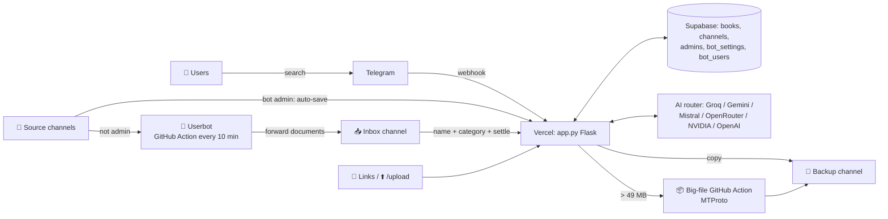

# 📚 filesbull — Telegram File / PDF Search Bot (open, reusable)

> **One repo → your own Telegram bot.** Fork or import this repo, deploy it on Vercel, fill in a few
> environment variables and you get the same bot with every feature: search, categories, join gate, Backup
> channel, userbot Inbox, link-se-file, upload page, AI and big files.
>
> **एक repo → आपका अपना Telegram bot.** इस repo को fork/import करो, Vercel पर deploy करो, कुछ
> environment variables भरो — और आपको यही bot मिल जाएगा, सारे features के साथ।

Live example: [@filesbull_bot](https://t.me/filesbull_bot)

**Contents / सूची:**
[1. What it does](#1-what-the-bot-does--bot-kya-karta-hai) ·
[2. Features](#2-features--how-each-works--features-aur-kaise-kaam-karte-hain) ·
[3. Architecture](#3-architecture--dhancha) ·
[4. Setup from zero](#4-setup-from-zero-step-by-step--shuru-se-setup) ·
[5. All variables](#5-all-environment-variables--saare-variables) ·
[6. GitHub Actions](#6-github-actions-userbot--big-files--github-actions) ·
[7. Admin guide](#7-admin-menu-guide--admin-menu) ·
[8. Troubleshooting](#8-troubleshooting--faq--samasya-aur-hal) ·
[9. Safety](#9-safety--copyright--suraksha)

---

## 1. What the bot does / बॉट क्या करता है

**English.** People send the bot the name of a book, PDF, subject or exam ("lucent gk", "ssc gd notes",
"polity hindi"). The bot searches its own database and sends the file straight into the chat. The owner fills
the database by forwarding files, by adding source channels, with a userbot that reads channels, by sending
web links, or through a password-protected upload page. Every file is saved once (no duplicates) in a private
**Backup channel**, so files survive even if the original channel is deleted.

**हिंदी.** लोग bot को किताब / PDF / subject / exam का नाम भेजते हैं ("lucent gk", "ssc gd notes")।
Bot अपने database में ढूंढकर file सीधे chat में भेज देता है। Owner files ऐसे जोड़ता है: forward करके, source channels
जोड़कर, userbot से (जो channels पढ़ता है), web link भेजकर, या password वाले upload page से। हर file एक ही बार
(बिना duplicate) private **Backup channel** में save होती है — original channel delete हो जाए तब भी file बची रहती है।

---

## 2. Features & how each works / Features और कैसे काम करते हैं

| Feature | English — how it works | हिंदी — कैसे काम करता है |
|---|---|---|
| 🔍 **Search + spelling/Hinglish** | Understands Hinglish, Hindi (Devanagari) and typos (`alg→alag`, `itihas = history`). With an AI key the AI reads the message first (cached 24 h); without AI a local parser does it. Results: 8 per page + "➡️ Aur dikhao". | Hinglish, हिंदी और गलत spelling समझता है। AI key हो तो AI पहले message समझता है, नहीं तो local parser। एक बार में 8 results + "➡️ Aur dikhao"। |
| 🗂️ **Categories** | Every file gets a subject category (GK, Polity, Maths, Notification…). New categories are made automatically. Users browse with the 🗂️ button. | हर file को subject category मिलती है। नई category अपने आप बनती है। User 🗂️ button से देखते हैं। |
| 🔒 **Join gate** | Optional: users must join your channels before they get files. `/admin → Join channels`. The bot must be admin there (for private channels it makes the invite link). | Optional: file पाने से पहले user को आपके channel join करने होंगे। Bot वहां admin होना चाहिए। |
| 💾 **Backup channel** | A private channel where the bot keeps one copy of every file. Search sends files from here. `/admin → 💾 Backup`. | Private channel जहां हर file की एक copy रहती है। Search यहीं से file भेजता है। |
| 👤 **Userbot Inbox → settle → Backup** | A second Telegram *account* (not the bot) reads source channels where the bot is NOT admin, including **old files** (backfill). It forwards files into a private **Inbox** channel every ~10 min (GitHub Action). The bot names + categorises each file and "settles" it into Backup. Files it can't understand wait in ❓ review. | एक दूसरा Telegram *account* (bot नहीं) उन channels को पढ़ता है जहां bot admin नहीं है — **पुरानी files** भी। हर ~10 min files private **Inbox** में आती हैं, bot नाम + category देकर Backup में डालता है। समझ न आए तो ❓ review में। |
| 📄 **Document-only filter** | The userbot keeps only study documents (PDF, DOC/DOCX, PPT, XLS, EPUB, TXT, ZIP/RAR/7Z…). Videos, photos, audio, stickers, polls, text/link posts are skipped (not errors). Your own forwards / links / uploads are never filtered. | Userbot सिर्फ documents लेता है (PDF, DOC, PPT, XLS, EPUB, ZIP…)। Video, photo, audio, text/link posts skip। आपकी खुद की forward / link / upload की files filter नहीं होतीं। |
| 📢 **Source channels + old-file backfill** | `/admin → Channels → ➕ Source`. If the bot is admin → it auto-saves new posts. If not → the userbot reads it (new + old files). `/status` shows how each channel's files get in. | Bot admin है तो नई posts खुद save। नहीं तो userbot पढ़ता है (नई + पुरानी)। `/status` में हर channel का हाल। |
| 🔗 **Link se file** (owner) | Send any file link in the bot's private chat (PDF, Google Drive file/folder/Docs, Dropbox, OneDrive, MediaFire, GitHub, public `t.me/channel/123`). Up to 10 links per message, or `/link <url>`. A web page link → the bot finds the PDFs on it (buttons + "Sab add karo"). Paid sites (Scribd etc.) and Mega are refused. Private/local addresses are blocked (SSRF safe). | Bot को कोई भी file link भेजो (PDF, Drive, Dropbox, OneDrive, MediaFire, GitHub, t.me post)। एक message में 10 तक। Website का link → उस page की PDFs ढूंढकर buttons। Scribd जैसी paid sites मना। |
| ⬆️ **/upload page** (owner) | `https://<your-app>.vercel.app/upload` — phone-friendly page, password protected (send `/upload` to the bot to get the password + a 15-min login link; `/uploadpass` = new password). Files go straight to private Supabase Storage (50 MB/file), then into the same Inbox pipeline. 5 wrong passwords → locked 30 min. | Phone के लिए upload page, password वाला। Bot में `/upload` भेजो — password + 15 min का login link मिलेगा। 50 MB तक per file। |
| 🤖 **AI agent mode** (owner chat) | In the owner's private chat you can just say what you want in Hinglish ("polity ki files dikhao", "is channel ko source bana do"). Every change asks ✅ Accept / ❌ Deny first. | Owner chat में Hinglish में बोलो क्या करना है। हर बदलाव से पहले ✅ Accept / ❌ Deny पूछता है। |
| ⚙️ **Admin menu** | `/admin` opens all buttons: Channels, Join channels, Backup, Log Chat, 👤 Userbot, 🔑 AI Keys, 🤖 AI Naming, 📂 All Files, review, users, status, restart. | `/admin` से सारे buttons। |
| 👮 **Sub-admins** | Owner adds helpers in `/admin → Admins` (their numeric id). Sub-admins manage files; owner-only things (keys, link, upload, userbot) stay with the owner. | Owner helpers जोड़ सकता है। Sub-admin files संभालते हैं; keys/link/upload/userbot सिर्फ owner। |
| ✅ **Review / Accept–Deny** | Renames, deletes, channel changes and AI suggestions are shown first with ✅ Accept / ❌ Deny. Files the bot can't name wait in ❓ review — send `naam | category`. | हर बदलाव पहले ✅/❌ से confirm। ❓ review वाली files को `naam | category` भेजकर नाम दो। |
| 📦 **Big files > 49 MB** | Telegram bots can only download 20 MB. For bigger files (rename, big links up to ~1.9 GB) the bot starts a **GitHub Action** that logs in over MTProto (Telegram API ID/HASH) and does the work, then reports back. | Bot API 20 MB से बड़ी file download नहीं कर सकता। बड़ी files के लिए bot GitHub Action चलाता है (MTProto)। |
| 🩺 **Health / setup** | `GET /` = health JSON (also fixes the webhook). `GET /setup` = first-run checklist page. `/setup` in the bot (owner) = same checklist. `/status` = channels, roles. Never shows secrets. | `/` health JSON, `/setup` setup checklist। Secrets कभी नहीं दिखते। |

---

## 3. Architecture / ढांचा



```
 Users ──search──▶ Telegram ──webhook──▶ Vercel (app.py) ◀──▶ Supabase DB
                                            │  ▲
          Source channel (bot admin) ───────┘  │ name + category + settle
          Source channel (not admin) ─▶ 👤 Userbot (GitHub Action) ─▶ 📥 Inbox ─┘
          🔗 link / ⬆️ upload ─────────────────▶ Vercel ─▶ 📥 Inbox ─▶ 💾 Backup
          > 49 MB ─▶ 📦 big-file GitHub Action (MTProto) ─▶ 💾 Backup / 📥 Inbox
```

Files: `app.py` (the whole bot, Flask on Vercel) · `tools/userbot_runner.py` (userbot, runs in GitHub Actions) ·
`tools/bigfile_runner.py` (big files, GitHub Actions) · `.github/workflows/` (userbot every 10 min, big files, keepalive) ·
`setup.sql` (database) · `.env.example` (all variables) · `vercel.json`.

How the Actions get secrets without storing them in GitHub: each run asks GitHub for an **OIDC token** (proof "I am
workflow X of repo Y on branch main"), sends it to your bot, and the bot gives that run only what it needs (userbot
session, API id/hash). Nothing secret lives in the repo.

**हिंदी:** GitHub Actions को secrets GitHub में नहीं रखने पड़ते। हर run GitHub से एक OIDC token लेता है (सबूत कि वो इसी
repo का workflow है) और आपका bot उसे जरूरी चीजें दे देता है।

---

## 4. Setup from zero (step by step) / शुरू से setup

You need (free): a Telegram account, a GitHub account, a [Vercel](https://vercel.com) account, a [Supabase](https://supabase.com) account.
जरूरत (सब free): Telegram, GitHub, Vercel, Supabase accounts।

### Step 1 — Copy the repo / Repo copy करो
GitHub → **Fork** (or "Use this template" / "Import repository"). Keep the branch name `main`.
GitHub पर **Fork** दबाओ (branch `main` ही रहने दो)।

### Step 2 — Create the bot / Bot बनाओ
Telegram → [@BotFather](https://t.me/BotFather) → `/newbot` → name → username (must end in `bot`) → copy the **token** → this is `BOT_TOKEN`.
Optional: `/setprivacy` → Disable (so the bot can read group messages), `/setuserpic`, `/setdescription`.
@BotFather → `/newbot` → नाम → username → जो token मिले वही `BOT_TOKEN` है।

### Step 3 — Your Telegram id / अपना Telegram ID
Send `/start` to [@userinfobot](https://t.me/userinfobot) → the number is `ADMIN_USER_IDS`. (Or skip: after deploy, `/start` your bot — it tells you your id while no owner is set.)
@userinfobot को `/start` भेजो — जो number आए वो `ADMIN_USER_IDS`।

### Step 4 — Database (Supabase) / Database
1. supabase.com → **New project** (any name, save the DB password somewhere safe).
2. **SQL Editor → New query →** paste the whole file [`setup.sql`](setup.sql) → **Run**. (Safe to run again.)
   *Or* set `SUPABASE_ACCESS_TOKEN` (supabase.com/dashboard/account/tokens) in Vercel and the bot creates the tables itself.
3. **Project Settings → API**: copy **Project URL** → `SUPABASE_URL`, and the **service_role / secret key** → `SUPABASE_SERVICE_ROLE_KEY`.

हिंदी: Supabase में नया project → SQL Editor में `setup.sql` paste करके Run → Project URL और service_role key copy करो।

### Step 5 — Deploy on Vercel / Vercel पर deploy
vercel.com → **Add New → Project → Import** your fork → Framework: *Other* (vercel.json handles it) →
**Environment Variables**: add at least the 4 required ones (see the table below / `.env.example`) → **Deploy**.
Your bot address is `https://<project-name>.vercel.app`.
Vercel → New Project → अपना fork import करो → Environment Variables में कम से कम 4 जरूरी variables → Deploy।

> Later changes to variables need **Deployments → ⋯ → Redeploy**. / Variable बदलने के बाद **Redeploy** करना होता है।

### Step 6 — First run / पहली बार चलाओ
Open **`https://<your-app>.vercel.app/setup`** once. It sets the Telegram webhook, checks every variable and table,
and lists what is left (✅ / ❌ / ➖ optional). Then send **`/start`** to your bot.
एक बार `https://<your-app>.vercel.app/setup` खोलो — webhook set होगा और checklist दिखेगी। फिर bot को `/start` भेजो।

### Step 7 — Admin setup inside the bot / Bot के अंदर admin setup
Send `/admin` (or `/setup` for the checklist):
1. **💾 Backup**: create a private channel → add your bot as admin (post/edit/delete) → forward one post from it to the bot.
2. **📝 Log Chat** (optional): a private channel/group for logs, same way.
3. **📢 Channels → ➕ Source**: channels whose files you want (`@username`, link or forward a post).
4. **🔒 Join channels** (optional): channels users must join first (bot must be admin there).
5. **🔑 AI Keys** (optional): paste an AI key (or put it in Vercel env).

`/admin` भेजो → 💾 Backup channel set करो (private channel, bot को admin बनाओ, उसकी post forward करो) → Source channels → Join channels (optional) → AI key (optional)।

### Step 8 — Userbot (optional) / Userbot
Needed only for channels where your bot is **not** admin.
1. my.telegram.org → API development tools → copy **api_id** → `TG_API_ID`, **api_hash** → `TG_API_HASH` (Vercel) → Redeploy.
2. Use a **second Telegram account** if possible (not your main one). Make it a member of your source channels.
3. Create a private channel **"Userbot Inbox"** (and optionally "Inbox Alerts"); add the bot **and** the userbot account as admins.
4. Bot → `/admin → 👤 Userbot → Login` (opens a login page; the session is stored encrypted in your DB) → **📥 Inbox storage → ➕** pick the Inbox channel.

सिर्फ उन channels के लिए जहां bot admin नहीं है। my.telegram.org से API ID/HASH → Vercel। दूसरा Telegram account इस्तेमाल करो, source channels join करो, Inbox channel बनाओ (bot + userbot दोनों admin) → `/admin → 👤 Userbot → Login`।

### Step 9 — GitHub Actions (optional, for userbot + big files) / GitHub Actions
1. In your fork: **Actions tab → "I understand my workflows, go ahead and enable them"** (GitHub turns Actions off in forks).
2. **Settings → Secrets and variables → Actions → Variables → New repository variable**: `BOT_URL` = `https://<your-app>.vercel.app`.
   (If your `GH_TOKEN` has *Variables: write*, the bot adds this itself — check `/setup`.)
3. Optional, for instant start: create a fine-grained token (github.com/settings/personal-access-tokens → only this repo →
   **Actions: Read and write**, **Variables: Read and write**) → Vercel `GH_TOKEN` → Redeploy.
No Actions **secrets** are needed. See [section 6](#6-github-actions-userbot--big-files--github-actions).

Fork में Actions enable करो → repo variable `BOT_URL` = आपका Vercel address → (optional) `GH_TOKEN` Vercel में। कोई secret GitHub में नहीं डालना।

---

## 5. All environment variables / सारे variables

Full list with comments: [`.env.example`](.env.example). In code: `CONFIG_VARS` at the top of `app.py`.
Never put a real token in the repo — only in Vercel. / असली token कभी repo में मत डालो, सिर्फ Vercel में।

| Variable | Need | Default | What / where from |
|---|---|---|---|
| `BOT_TOKEN` | **required** | — | @BotFather → /newbot |
| `SUPABASE_URL` | **required** | — | Supabase → Project Settings → API → Project URL |
| `SUPABASE_SERVICE_ROLE_KEY` | **required** | — | Supabase → API keys → service_role (server only) |
| `ADMIN_USER_IDS` | **required** | — | Owner id(s), comma separated (@userinfobot) |
| `GROQ_API_KEY` (`_2`, `_3`) | recommended | — | console.groq.com/keys (free) |
| `GEMINI_API_KEY` (`_2`, `GOOGLE_API_KEY`) | optional | — | aistudio.google.com/apikey |
| `MISTRAL_API_KEY` (`_2`) | optional | — | console.mistral.ai |
| `OPENROUTER_API_KEY` (`_2`) | optional | — | openrouter.ai/keys |
| `NVIDIA_API_KEY` (`_2`) | optional | — | build.nvidia.com |
| `OPENAI_API_KEY` / `OPENAI_MODEL` | optional | gpt-5-mini | platform.openai.com |
| `GROQ_MODEL` | optional | auto | pin a Groq model |
| `AI_DAILY_PER_USER` / `AI_DAILY_LIMIT` | optional | 12 / 2000 | AI limits |
| `AI_UNDERSTAND` / `AI_UNDERSTAND_DAILY` | optional | 1 / 40 | AI reads messages first |
| `AI_RANK` | optional | off | AI re-ranks results |
| `ADMIN_AI_DAILY` / `AI_NAME_DAILY` / `AGENT_AI_DAILY` | optional | 60 / 600 / 300 | AI limits for admin |
| `TG_API_ID` / `TG_API_HASH` | recommended | — | my.telegram.org → API development tools |
| `GH_TOKEN` | recommended | — | GitHub fine-grained token (Actions + Variables write) |
| `GH_REPO` | optional | auto (Vercel git repo) | owner/repo of the Actions |
| `GH_BRANCH` | optional | main | branch of the Actions |
| `WEBHOOK_SECRET` | optional | from BOT_TOKEN | Telegram webhook secret |
| `USERBOT_SECRET` / `BIGFILE_SECRET` / `UPLOAD_SECRET` | optional | from BOT_TOKEN | signing/encryption keys |
| `UPLOAD_PASSWORD` | optional | bot makes one | /upload page password |
| `UPLOAD_BUCKET` | optional | filesbull-uploads | Supabase Storage bucket (auto-created) |
| `WEB_INLINE_MAX_MB` | optional | 49 | bigger links go via GitHub Action |
| `UB_MAX_PER_RUN` | optional | 40 | userbot files per run |
| `BOT_NAME` | optional | bot's Telegram name | display name in texts |
| `PUBLIC_URL` | optional | auto (Vercel) | only if not on Vercel / custom domain |
| `SUPABASE_ACCESS_TOKEN` | optional | — | bot creates tables itself |
| `DIAG_TOKEN` / `DIAG_TOKEN_SHA256` | optional | off | developer diagnostics endpoints |

**GitHub (repo → Settings → Secrets and variables → Actions):** variable `BOT_URL` = your bot address. No secrets needed
(optional secrets `BOT_TOKEN`, `TG_API_ID`, `TG_API_HASH` are used by the big-file job if present).

⚠️ If you ever **change `BOT_TOKEN`**, the keys derived from it change too: the userbot must log in again and the
upload password is reset — unless you had set `USERBOT_SECRET` / `UPLOAD_SECRET` yourself.
`BOT_TOKEN` बदलने पर userbot को दोबारा login करना पड़ेगा (जब तक `USERBOT_SECRET` खुद set न किया हो)।

---

## 6. GitHub Actions (userbot + big files) / GitHub Actions

| Workflow | When | What |
|---|---|---|
| `userbot-forward.yml` | every 10 min + when the bot starts it ("🔄 Abhi check karo") | userbot reads source channels → documents → 📥 Inbox |
| `bigfile-rename.yml` | when the bot starts it + every 5 min if jobs wait | files > 20/49 MB: rename, big links |
| `keepalive.yml` | after every push + every 5 min | opens your bot's `/` → webhook checked/fixed, function kept warm |

Which bot a run talks to: the `bot_url` input (the bot fills it when it starts a run) → repo variable `BOT_URL`.
A fork without `BOT_URL` simply stops with a clear note (no error, no calls to anybody else's bot).
Security: the bot only answers a run whose OIDC token says *this repo* (`GH_REPO`, auto-detected from Vercel),
branch `main`, and the exact workflow file.

हिंदी: Run को पता कैसे चलता है किस bot से बात करनी है — `bot_url` input (bot खुद भेजता है) या repo variable `BOT_URL`।
Fork में `BOT_URL` नहीं है तो run आराम से रुक जाता है।

---

## 7. Admin menu guide / Admin menu

| Command | Who | What |
|---|---|---|
| `/start`, `/help`, `/search <naam>`, `/myid` | everyone | use the bot / see your id |
| `/admin` | owner + sub-admins | all admin buttons |
| `/setup` | owner | setup checklist |
| `/status` | admins | roles, channels, how each channel's files get in |
| `/restart` | admins | re-set webhook |
| `/keys` | owner | AI keys |
| `/link <url>` | owner | add a file from a link (or just paste links) |
| `/upload`, `/uploadpass` | owner | upload page link + password / new password |
| `/logs [n]` | owner | recent logs |
| `/addchannel`, `/requirechannel`, `/requiredchannels`, `/removerequired` | admins | channels / join gate |

Owner's private chat also understands plain Hinglish ("sari files dikhao", "X ka naam Y kar do", "backup channel set karo").
Owner chat में सीधी Hinglish भी चलती है।

---

## 8. Troubleshooting / FAQ — समस्या और हल

| Problem | Fix |
|---|---|
| Bot doesn't reply / जवाब नहीं | Open `https://<app>.vercel.app/setup` → fix ❌. Check `BOT_TOKEN`, then **Redeploy**. Health `/` → `webhook_registered: true`. |
| "Missing: …" on `/` or `/setup` | Add those variables in Vercel → Redeploy. |
| "Database tables missing" | Run `setup.sql` in Supabase SQL Editor (or set `SUPABASE_ACCESS_TOKEN`). |
| I'm not admin / "⛔ admin only" | Your id must be in `ADMIN_USER_IDS` (send `/myid`), then Redeploy. |
| Channel add fails | Make the bot admin in that channel first; for channels where it can't be admin use the userbot. |
| Userbot not forwarding | Fork: enable Actions + set variable `BOT_URL`. Userbot account must be a member of the channels and admin in the Inbox. `/admin → 👤 Userbot` shows the state. |
| Big file stuck | `TG_API_ID` + `TG_API_HASH` set? Actions enabled? The 5-min schedule picks it up even without `GH_TOKEN`. |
| AI says no / AI off | Add any one AI key (Vercel or `/admin → 🔑 AI Keys`). The bot works without AI too. |
| Upload page password? | Send `/upload` to the bot (owner). `/uploadpass` makes a new one. |
| Webhook set by hand → bot gives 401 | Don't use a plain `setWebhook?url=…` link (it has no secret). Just open `/` or `/setup` again — the bot sets it correctly. |
| Link "direct file link nahi" | It was a web page with no file; send the direct PDF link, or a page that lists PDFs. Paid/DRM sites are refused on purpose. |

**Better search names / अच्छे नाम:** a caption like `SSC English | Objective English | grammar` helps search.
Caption में subject/exam लिखो तो search बेहतर होता है।

**Local test (developers):**
```bash
python3 -m venv .venv && source .venv/bin/activate
pip install -r requirements.txt
cp .env.example .env      # fill it, then: set -a; source .env; set +a
python app.py             # http://localhost:8080/  and  /setup  show what is missing (names only)
```

---

## 9. Safety & copyright / सुरक्षा

- **Never share** your `BOT_TOKEN`, `SUPABASE_SERVICE_ROLE_KEY`, AI keys, `TG_API_HASH`, GitHub token or the userbot login code with anyone — not in chats, screenshots, issues or commits. Put them only in Vercel.
  अपना token / keys / login code किसी को मत भेजो — chat, screenshot, GitHub कहीं भी नहीं। सिर्फ Vercel में।
- A leaked token? BotFather → `/revoke`, make a new one, update Vercel, Redeploy. Rotate the other key the same way at its provider.
- The bot never prints secrets: health pages show only names and yes/no.
- **Copyright:** share only files you are allowed to share (free government PDFs, your own notes, material with permission). The bot refuses paid document sites (Scribd etc.) and does not bypass paywalls or DRM. You are responsible for what your bot shares.
  **Copyright:** सिर्फ वही files share करो जिनकी इजाज़त है (free सरकारी PDFs, अपने notes, permission वाली files)। Paid sites और DRM bypass नहीं होता। आपका bot क्या share करता है, ये आपकी जिम्मेदारी है।
- Use a separate Telegram account for the userbot; heavy automation on your main account can get it limited.
  Userbot के लिए अलग Telegram account रखो।

---

Made for Hindi-medium exam students. PRs and forks welcome. 🙏
